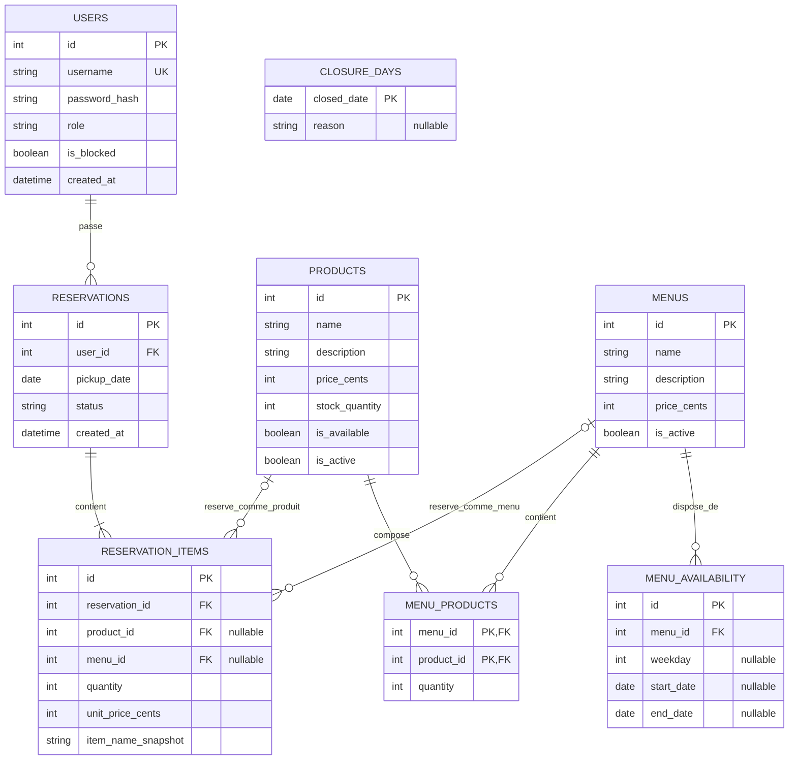

# Pol-eat-heck — Base de données

## Équipe

| Nom | GitHub | Partie |
|---|---|---|
| YOUNES Ralph | [RalphYounes](https://github.com/RalphYounes) | Base de données |
| SID Ryan | [kyp022](https://github.com/kyp022) | Backend |
| M'HANNIHA Zyad | [AKaz23](https://github.com/AKaz23) | Frontend |

## Dépôts GitHub

| Partie | Nom du dépôt | Lien |
|---|---|---|
| Base de données | 4a-isi-projet-db | [GitHub](https://github.com/RalphYounes/4a-isi-projet-db) |
| Backend | 4a-isi-projet-back | [GitHub](https://github.com/kyp022/4a-isi-projet-back) |
| Frontend | 4a-isi-projet-front-akaz | [GitHub](https://github.com/AKaz23/4a-isi-projet-front-akaz) |

## Diagramme de la base de données (ERD)

On est partis sur **8 tables** pour gérer les utilisateurs, les produits, les menus, les disponibilités, les fermetures et les réservations. Voici notre diagramme :

Quelques points importants :
- Un menu peut contenir plusieurs produits, d'où la table `MENU_PRODUCTS`.
- Une réservation peut contenir plusieurs produits ou menus. Chaque ligne de `RESERVATION_ITEMS` correspond à **un produit ou un menu**, pas les deux.
- `MENU_AVAILABILITY` sert à gérer les jours et périodes où un menu est proposé.
- `CLOSURE_DAYS` n'a pas de lien direct avec une autre table : les jours de fermeture concernent tout l'établissement.
- Les mots de passe seront stockés sous forme de hash et les utilisateurs bloqués ne pourront pas réserver.

Pour l'instant, c'est le **modèle de la base de données**. La création des tables SQLite et leur utilisation avec SQLModel seront faites à partir de ce schéma.